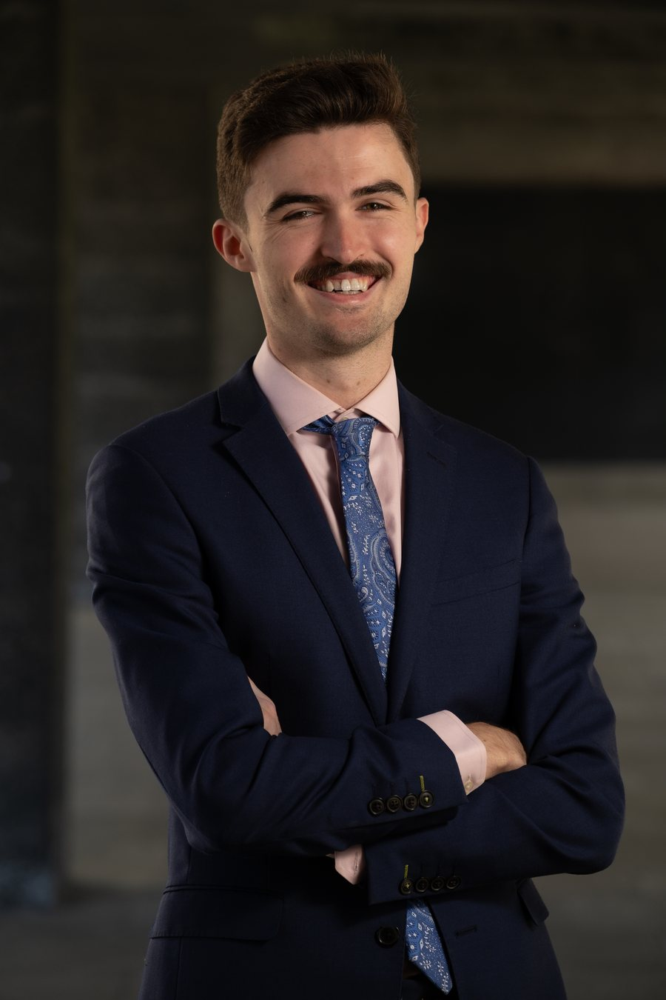

# Fergus McCormack

PhD Candidate in Economics University of Cambridge

I am on the <strong>2026–27 academic job market</strong>.

<a class="btn btn-primary" href="papers/McCormack_JMP_The_Depression_Trap.pdf">Job Market Paper (PDF)</a> <a class="btn" href="papers/McCormack_CV.pdf">Curriculum Vitae (PDF)</a>

<a href="mailto:fm527@cam.ac.uk">fm527@cam.ac.uk</a> &middot; Faculty of Economics, University of Cambridge

## About

I am a PhD candidate in Economics at the [University of Cambridge](https://www.econ.cam.ac.uk/), supervised by [Eric French](https://www.econ.cam.ac.uk/people/academic/eric-french) and advised by [Weilong Zhang](https://www.econ.cam.ac.uk/people/academic/weilong-zhang). My research lies at the intersection of **health economics**, **labor economics**, and **genoeconomics**. I study how genetic risk for mental illness shapes labor supply, health, and treatment decisions over the life cycle, and what this implies for the design of mental health policy.

My work combines structural life-cycle models with panel data methods and Mendelian randomization, drawing on UK household panel data (Understanding Society), the UK Biobank, and Norwegian administrative data linked to molecular genetic information.

Before my PhD, I completed the MPhil in Economic Research at Cambridge and an MA in Economics at the University of Edinburgh, and I worked as a trainee at the European Central Bank. In autumn 2025 I was a visiting researcher at the University of Oslo, hosted by Eivind Ystrøm.

## Job Market Paper

### [The “Depression Trap”: Genetic Risk, Labor Supply, and the Case for Precision Psychiatry](papers/McCormack_JMP_The_Depression_Trap.pdf)

with Qianyu Yang &middot; <a href="papers/McCormack_JMP_The_Depression_Trap.pdf">Download PDF</a>

Why is depression linked to persistent non-employment, and how can mental health care be better targeted to improve mental health and employment outcomes? Using longitudinal UK panel data, we provide evidence for the “depression trap”: a self-reinforcing cycle of poor mental health and non-employment, using event studies of depression recurrences and redundancies. Early treatment could disrupt this cycle, but it is challenging to predict who will enter the trap. We show that a Polygenic Index for depressive symptoms constructed using molecular genetics data is a uniquely powerful predictor of the depression trap and its persistence. We embed the depression trap mechanism in a structural life-cycle model of health, labor supply and treatment, and evaluate using genetics data to allocate treatment. We find that targeting therapy towards individuals with high genetic risk for depression improves the clinical efficacy of treatment by 29%. Furthermore, we estimate that by increasing employment through improved treatment allocation, the information provided by genetic risk generates a net fiscal surplus sufficient to finance the cost of universal genotyping.

Working papers and work in progress are listed on the [Research](research) page.

## References

<strong><a href="https://www.econ.cam.ac.uk/people/academic/eric-french">Eric French</a></strong> Montague Burton Professor of Industrial Relations and Labour Economics University of Cambridge

<strong><a href="https://www.econ.cam.ac.uk/people/academic/weilong-zhang">Weilong Zhang</a></strong> Associate Professor of Economics University of Cambridge

<strong><a href="https://www.econ.cam.ac.uk/people/academic/kai-liu">Kai Liu</a></strong> Professor of Economics University of Cambridge

Contact details for my references are given in my [CV](cv).

## Contact

Fergus McCormack 
Faculty of Economics, University of Cambridge 
Darwin College, Cambridge CB3 9EU, United Kingdom 
Email: [fm527@cam.ac.uk](mailto:fm527@cam.ac.uk)
